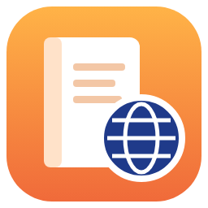
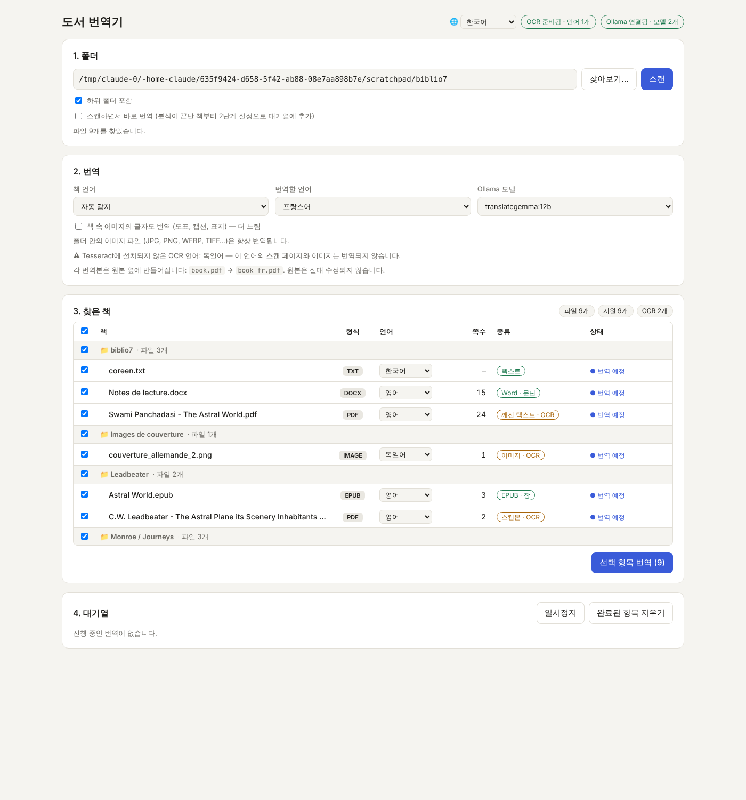
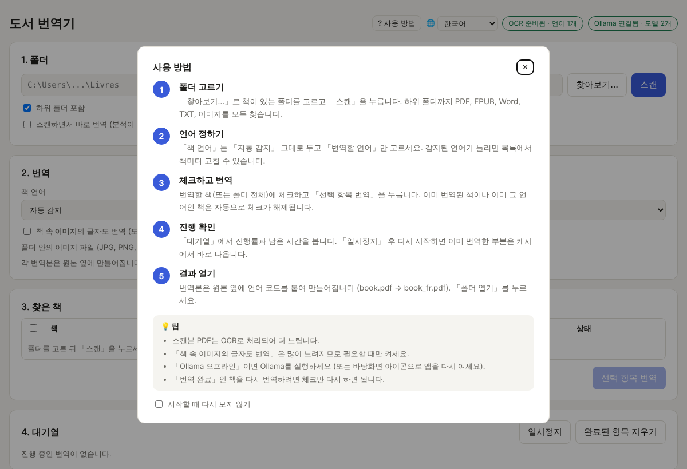

<h1 align="center">Book Translator · 도서 번역기</h1>

  내 PC에서, 인터넷 없이, 폴더 안의 책을 통째로 번역합니다. 
  PDF · EPUB · Word · TXT · 이미지 — 그림과 레이아웃은 그대로.

  

## 무엇을 하나요

- **폴더 하나만 고르면 끝** — 하위 폴더까지 책을 모두 찾아서 차례로 번역합니다.
- **레이아웃 보존** — PDF는 같은 자리에 번역문을 다시 쓰고, 그림·표지·도표는 그대로 둡니다.
- **스캔본도 OK** — OCR(Tesseract)로 읽어서 번역합니다. 이미지 속 글자도 번역할 수 있습니다.
- **언어 자동 감지** — 책마다 언어를 알아서 찾고, 이미 번역된 책은 다시 하지 않습니다.
- **100% 로컬** — Ollama의 TranslateGemma 모델이 내 컴퓨터에서 돌아갑니다. 책이 밖으로 나가지 않습니다.
- **원본은 그대로** — 번역본은 원본 옆에 `책_fr.pdf`처럼 만들어집니다.
- **12개 언어 화면** — 한국어, English, 中文, Español, Français, العربية, Português, Русский, 日本語, Deutsch, Italiano, Nederlands.

## 설치 (원클릭)

1. 위의 **무료 다운로드** 버튼으로 `BookTranslator_Setup.exe`를 받아 실행합니다.
   (서명되지 않은 파일이라 Windows가 경고하면 「추가 정보」 → 「실행」)
2. 언어와 AI 모델을 고릅니다 — **4b**(3.3 GB, 대부분의 PC) 또는 **12b**(8.1 GB, 그래픽 메모리 8 GB 이상).
3. Python, Tesseract OCR, Ollama, 모델까지 자동으로 설치됩니다.
4. 바탕화면의 **Book Translator** 아이콘을 누르면 끝.

처음 실행하면 「사용 방법」 창이 열립니다.

## Formats

| 형식 | 방법 |
|---|---|
| PDF (텍스트) | 블록마다 지우고 같은 자리에 번역문을 다시 씀 |
| PDF (스캔본) | OCR, 종이 색으로 덮고 번역문을 씀 |
| EPUB | XHTML의 글자만 바꿈 — 이미지·CSS·목차 그대로 |
| DOCX | 굵게·기울임·링크 등 서식을 유지 |
| TXT / MD | 코드·표·머리말은 보호 |
| 이미지 | OCR → 글자 지우기(인페인팅) → 같은 색으로 번역문 |

---

**English** — Translate whole folders of books (PDF, EPUB, DOCX, TXT, images) locally with Ollama, keeping images and layout. Download the one-click Windows installer above.

**Français** — documentation complète : [LISEZMOI.md](LISEZMOI.md).
